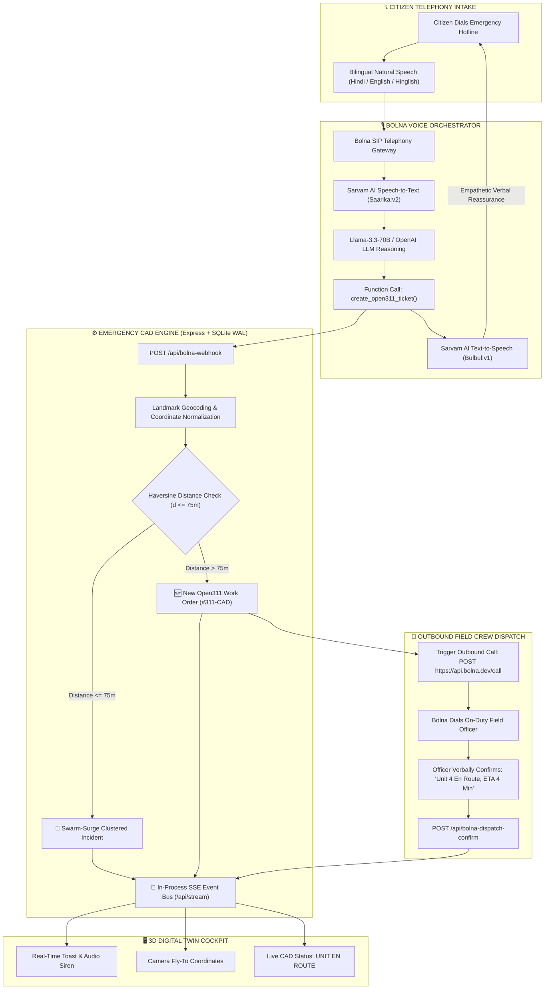
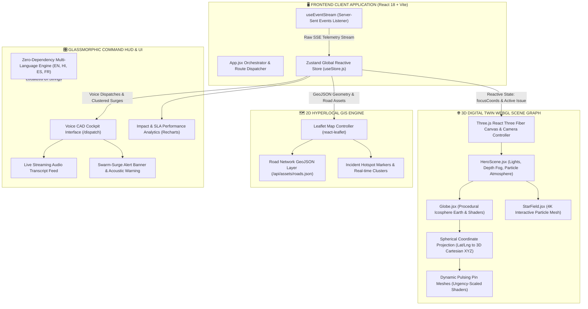

# 🌍 Community Hero — Autonomous Voice AI Civic & Emergency Command Center

> An enterprise-grade, closed-loop civic intelligence and emergency CAD (Computer-Aided Dispatch) platform powered by **Bolna Voice AI**, **Sarvam Indic Speech Models**, **Open311 v2 Standard**, and a **Three.js 3D Digital Twin Command Cockpit**.

[](https://opensource.org/licenses/MIT)
[](https://nodejs.org/)
[](https://react.dev/)
[](https://threejs.org/)
[](https://bolna.ai)
[](https://sarvam.ai)
[](https://www.open311.org)
[-003b57.svg)](https://sqlite.org)

> **Autonomous Municipal Emergency & Civic Operating System**  
> *Transforming fragmented 311/911 reporting into an autonomous, sub-second, bilingual voice-to-dispatch CAD infrastructure.*  
>  
> **Community Hero = Bilingual Bolna Voice AI + Open311 v2 Engine + 75m Spatial Haversine Deduplication + Autonomous Outbound Field Dispatch + 3D Earth Digital Twin Cockpit**

---

## 🌐 Subsystem Architecture & Operational Topology

| Subsystem / Layer | Technology & Provider | Status | Interface / Endpoint |
| :--- | :--- | :---: | :--- |
| **🎙️ Voice Dispatch Cockpit** *(Core Feature)* | React 18 + Three.js + SSE (Global Edge) | 🟢 **Operational** | **[`/dispatch`](http://localhost:5173/dispatch)** |
| **🌐 3D Digital Twin Earth** | Three.js + React Three Fiber | 🟢 **Operational** | **[`/`](http://localhost:5173/)** |
| **🗺️ Hyperlocal 2D Incident Map** | React-Leaflet + OpenStreetMap + Road GIS | 🟢 **Operational** | **[`/map`](http://localhost:5173/map)** |
| **🛡️ Municipal Admin Work-Order Portal** | React 18 + SLA Engine + Recharts | 🟢 **Operational** | **[`/admin`](http://localhost:5173/admin)** |
| **⚙️ Express API Gateway & CAD Core** | Node.js Express + SQLite WAL | 🟢 **Operational** | **[`/api`](http://localhost:4000/api)** |
| **📡 Real-Time SSE Event Bus** | Server-Sent Events Engine | 🟢 **Operational** | **[`/api/stream`](http://localhost:4000/api/stream)** |
| **🏛️ Open311 v2 GeoReport API** | Open311 GeoReport Specification | 🟢 **Compliant** | **[`/open311/v2/services.json`](http://localhost:4000/open311/v2/services.json)** |
| **🤖 Bolna Inbound/Outbound Agent** | Bolna Voice AI + Sarvam (`saarika` & `bulbul`) | 🟢 **Connected** | Config in [`bolna_agent_config.json`](./bolna_agent_config.json) |

---

## 🎯 Problem Statement

Municipal corporations and emergency dispatch centers (911/311, Emergency 112) consistently face **three fundamental operational bottlenecks**:

1. **High-Panic Cognitive Barrier:** When an underground commercial gas leak occurs or an 11kV electrical transformer sparks over a crowded pedestrian footpath, citizens cannot fill out complex multi-step mobile web forms. Traditional telephone hotlines subject callers to **15-minute rigid IVR phone trees** (*"Press 1 for Water, Press 2 for Electricity"*), resulting in high call abandonment rates during critical life-safety hazards.
2. **Swarm-Surge Overload (The Duplicate Avalanche):** During major infrastructure hazards, 30 to 60 citizens independently call dispatch about the exact same fire or water blowout. Human dispatchers are overwhelmed by duplicate tickets, tying up phone lines and delaying emergency response times by **20–40 minutes**.
3. **Broken Closed-Loop Dispatch:** Traditional civic portals operate as passive dumpboxes. There is no automated, sub-second outbound communication to on-duty field units, and citizens receive zero feedback on whether emergency repair crews have actually been mobilized.

---

## 💡 The Solution: Community Hero

**Community Hero** delivers an **autonomous, closed-loop voice AI emergency operating system**:
* **Bilingual Inbound Triage:** Citizens dial in and speak naturally in **Hindi, English, or conversational Hinglish**. Powered by **Bolna Voice AI** and **Sarvam AI**, the agent empathetically triages the hazard, extracts landmarks, and assesses threat levels with sub-second latency.
* **Autonomous Open311 CAD Generation:** The voice agent instantly invokes function calling (`create_open311_ticket`) with zero human intervention.
* **Swarm-Surge Spatial Deduplication (<75m–500m):** When duplicate calls flood in, an algorithmic Haversine check clusters them under the active incident, escalates urgency, and reassures the caller: *"We have already logged this hazard under Ticket #311-CP. Rapid Response Unit 4 is already en route with sirens."*
* **Autonomous Outbound Field Dispatch:** Bolna autonomously places an outbound phone call to the nearest municipal field engineer to verbally confirm their dispatch and calculate arrival ETA.
* **Live 3D Digital Twin Telemetry:** Real-time Server-Sent Events (SSE) project every stage live onto an interactive 3D Globe and Emergency CAD Cockpit.

---

## 📊 Core Architectural & Engineering Diagrams

### 1. End-to-End Autonomous Voice AI Emergency Dispatch Lifecycle



---

### 2. Frontend 3D Digital Twin & Reactive State Architecture



---

### 3. Swarm-Surge Deduplication & Spatial Clustering State Machine

```mermaid
flowchart LR
    INCOMING["Incoming Emergency Call (lat, lon, incident_type)"] --> QUERY["Query Active Unresolved Tickets in Category"]
    QUERY --> CALC["Compute Haversine Great-Circle Distance (d in meters)"]
    CALC --> EVAL{"Is Distance d <= 75m?"}

    EVAL -->|Yes: Duplicate Cluster| CLUSTER["🚨 Swarm-Surge Escalation"]
    CLUSTER --> LINK["Link to Parent Ticket ID (duplicate_of = parent_id)"]
    LINK --> ESCALATE["Escalate Priority to CRITICAL (Urgency: 10.0)"]
    ESCALATE --> BROADCAST_SURGE["Emit INCIDENT_CLUSTER_SURGE to SSE Bus"]
    BROADCAST_SURGE --> RESPOND_CLUSTERED["Voice Agent: 'Incident already logged. Units en route.'"]

    EVAL -->|No: New Incident| ISOLATED["🆕 New Municipal Work Order"]
    ISOLATED --> ALLOCATE["Assign Open311 ID & Routing Department"]
    ALLOCATE --> SLA["Calculate SLA Countdown & Target Resolution Time"]
    SLA --> BROADCAST_NEW["Emit NEW_VOICE_DISPATCH to SSE Bus"]
    BROADCAST_NEW --> CALL_CREW["Initiate Outbound Call to Field Unit"]
    CALL_CREW --> RESPOND_NEW["Voice Agent: 'Emergency Work Order created. Team dispatched.'"]
```



---

## 🧬 Mathematical Formulations & Core Algorithms

### 1. Haversine Spatial Deduplication Equation
To prevent redundant work orders without querying external geofencing APIs, Community Hero computes great-circle distances directly in Node.js using the spherical Haversine formula:

$$\Delta\phi = (\text{lat}_2 - \text{lat}_1) \cdot \frac{\pi}{180}, \quad \Delta\lambda = (\text{lon}_2 - \text{lon}_1) \cdot \frac{\pi}{180}$$

$$a = \sin^2\left(\frac{\Delta\phi}{2}\right) + \cos\left(\text{lat}_1 \cdot \frac{\pi}{180}\right) \cdot \cos\left(\text{lat}_2 \cdot \frac{\pi}{180}\right) \cdot \sin^2\left(\frac{\Delta\lambda}{2}\right)$$

$$c = 2 \cdot \text{atan2}\left(\sqrt{a}, \sqrt{1 - a}\right)$$

$$d = R_{\text{earth}} \cdot c \quad (\text{where } R_{\text{earth}} = 6{,}371{,}000 \text{ meters})$$

$$\text{Decision Rule: } \begin{cases} d \le 75\text{m} \implies \text{Cluster into existing incident (Swarm Surge)} \\ d > 75\text{m} \implies \text{Instantiate new Open311 work order} \end{cases}$$

---

### 2. 3D Spherical Trigonometry Mapping (Three.js Virtual Earth)
Geographic coordinates on Earth's ellipsoidal surface are mapped into Three.js 3D Cartesian coordinates $(X, Y, Z)$ on an icosphere of radius $R$:

$$\phi = (90 - \text{lat}) \cdot \frac{\pi}{180}, \quad \theta = (\text{long} + 180) \cdot \frac{\pi}{180}$$

$$X = -R \cdot \sin(\phi) \cdot \cos(\theta)$$
$$Y = R \cdot \cos(\phi)$$
$$Z = R \cdot \sin(\phi) \cdot \sin(\theta)$$

Pins dynamically pulse with glowing shaders scaled by the incident's real-time urgency rating ($1.0 \le U \le 10.0$).

---

### 3. Dynamic Urgency Score & SLA Decay Model
Every incident receives an urgency score $U(t)$ that scales with cluster call frequency and decays as repair response targets near breach:

$$U(t) = w_s \cdot S_{\text{base}} + w_p \cdot P_{\text{caller}} + w_c \cdot \log_2(1 + N_{\text{calls}}) + \lambda_{\text{SLA}} \cdot \max\left(0, 1 - \frac{t_{\text{remaining}}}{\text{SLA}_{\text{total}}}\right)$$

* $S_{\text{base}} \in [1, 5]$: AI-inferred baseline severity (e.g., Gas Leak = 5, Broken Streetlight = 2)
* $P_{\text{caller}} \in [1, 10]$: Caller vocal panic and urgency rating extracted from acoustic cues
* $N_{\text{calls}}$: Count of deduplicated voice calls clustered under this incident
* $\lambda_{\text{SLA}}$: Penalty weight escalating unresolved tickets towards emergency supervisor alerts

---

## ✨ Persona Capabilities

### 👤 Citizen Persona
* **Zero-Download Voice Hotline:** Call directly from any landline or mobile device in Hindi, English, or Hinglish.
* **Hyperlocal 3D Web App:** View reported issues on an interactive 3D Globe with glassmorphism UI.
* **Gamification & Hero Badges:** Earn XP (50 XP for reporting, 10 XP for verifying) and unlock civic badges.
* **Multilingual UI:** Native interface support for English, हिन्दी, Español, and Français.

### 🚓 Field Officer Persona
* **Automated Voice Phone Dispatch:** Receive an instant phone call with synthesized details of the hazard.
* **Verbal Confirmation:** Speak naturally to confirm dispatch (*"Unit 4 en route, ETA 5 minutes"*).
* **Multimodal Vision Proof:** Upload resolution proof photos verified by AI computer vision against the original report.

### 🛡️ Municipal Dispatcher Persona
* **Real-Time CAD Cockpit (`/dispatch`):** Monitor active voice calls, live transcripts, and swarm clusters.
* **Open311 Standard Compliance:** Full compatibility with municipal ticketing systems (GeoReport v2).
* **SLA Breach Warnings:** Live countdowns with visual and acoustic alerts when work orders near SLA limits.

---

## 🎙️ Declarative Voice Agent Architecture

The voice AI dispatch agent is specified declaratively in [`bolna_agent_config.json`](./bolna_agent_config.json):

```json
{
  "$schema": "https://bolna.ai/schemas/agent-config.v1.json",
  "project": "Community Hero — Autonomous Closed-Loop Voice AI Civic & Emergency Command Center",
  "version": "2.0.0",
  "inbound_agent": {
    "agent_name": "Community Hero Triage Agent",
    "language": "hi-en",
    "stt_provider": "sarvam_ai",
    "stt_model": "saarika:v2",
    "llm_provider": "groq",
    "llm_model": "llama-3.3-70b-versatile",
    "tts_provider": "sarvam_ai",
    "tts_model": "bulbul:v1",
    "tts_voice": "hi-IN-kavya",
    "tools": [
      {
        "type": "function",
        "function": {
          "name": "create_open311_ticket",
          "description": "Create an Open311 municipal emergency work order or deduplicate into an active swarm surge cluster."
        }
      }
    ]
  }
}
```

---

## 🏛️ Open311 v2 GeoReport API Endpoints

Community Hero adheres strictly to the official **Open311 v2 GeoReport standard**:

| Method | Endpoint | Description |
| :--- | :--- | :--- |
| `GET` | `/open311/v2/services.json` | Returns list of available municipal service request types |
| `GET` | `/open311/v2/requests.json` | Query active municipal work orders with spatial filtering |
| `GET` | `/open311/v2/requests/:id.json` | Detailed view of a single work order and its audit trail |
| `POST` | `/open311/v2/requests.json` | Ingest new service request with location, photo, and metadata |

---

## 🗂️ Complete Codebase Structure

```text
community-hero/
├── backend/
│   ├── src/
│   │   ├── db/
│   │   │   ├── init.js               # SQLite database boot & schema migrations
│   │   │   └── seed.js               # 40 realistic municipal seed tickets & 200 heroes
│   │   ├── routes/
│   │   │   ├── bolna.js              # Bolna Voice AI webhooks, dispatch & simulator
│   │   │   ├── issues.js             # Issue CRUD, upvotes, status transitions
│   │   │   ├── open311.js            # Open311 v2 GeoReport API compliance
│   │   │   ├── pulse.js              # City Pulse passive sentiment listening
│   │   │   ├── stream.js             # Server-Sent Events (SSE) live push stream
│   │   │   └── users.js              # User profiles, XP engine & leaderboard
│   │   ├── services/
│   │   │   ├── voiceDispatch.js      # Haversine deduplication, CAD engine & Bolna API
│   │   │   ├── events.js             # In-memory pub/sub event bus
│   │   │   ├── assets.js             # GIS road network point-in-segment classifier
│   │   │   ├── routing.js            # Municipal department routing & SLA engine
│   │   │   └── sentiment.js          # Lexicon-based real-time sentiment scoring
│   │   └── server.js                 # Express application root (:4000)
│   ├── package.json
│   └── .env
├── frontend/
│   ├── src/
│   │   ├── components/
│   │   │   ├── VoiceDispatchCockpit.jsx  # Real-time Voice CAD command center
│   │   │   ├── IssueMap.jsx              # Hyperlocal Leaflet 2D street map
│   │   │   ├── Navbar.jsx                # Glassmorphism header with live SSE status
│   │   │   └── AssistantWidget.jsx       # Floating natural-language civic assistant
│   │   ├── pages/
│   │   │   ├── VoiceCockpitPage.jsx      # Dedicated route for /dispatch
│   │   │   ├── Landing.jsx               # Hero 3D showcase & value proposition
│   │   │   ├── MapPage.jsx               # Fullscreen incident explorer
│   │   │   ├── Dashboard.jsx             # Visualized city analytics with Recharts
│   │   │   └── Admin.jsx                 # Municipal dispatcher work order queue
│   │   ├── scenes/
│   │   │   └── Globe.jsx                 # Three.js 3D procedural icosphere Earth
│   │   ├── store/
│   │   │   └── useStore.js               # Zustand global reactive state management
│   │   └── App.jsx                       # Route orchestration & SSE listener
│   ├── package.json
│   └── vite.config.js
├── docs/
│   ├── ARCHITECTURE.md                   # Full system architecture specification
│   ├── VIVA_PRESENTATION_GUIDE.md        # Technical defense cheatsheet
│   └── Community_Hero_Jury_Presentation.pdf # Presentation slide deck
├── bolna_agent_config.json               # Bolna Voice AI agent declarative schema
└── README.md
```

---

## 🚀 Quick Start Guide

### 1. Prerequisites
* **Node.js**: `v20.0.0` or higher
* **npm**: `v10.0.0` or higher

### 2. Clone & Install
```bash
git clone https://github.com/Aarush-bigO/community-hero.git
cd community-hero

# Install backend dependencies
cd backend && npm install && cd ..

# Install frontend dependencies
cd frontend && npm install && cd ..
```

### 3. Launch Development Servers

**Terminal 1 — Backend API Gateway:**
```bash
cd backend
npm run dev
# -> Server running on http://localhost:4000
```

**Terminal 2 — Frontend 3D Web App:**
```bash
cd frontend
npm run dev
# -> Client running on http://localhost:5173
```

Navigate to **`http://localhost:5173/dispatch`** to experience the **Autonomous Voice CAD Cockpit**! 🎙️

---

## 📄 License & Attribution

Distributed under the **MIT License**. See [`LICENSE`](./LICENSE) for full details.
